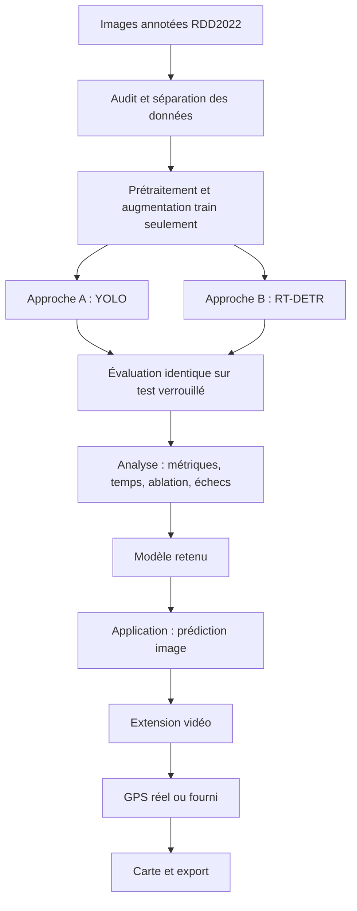
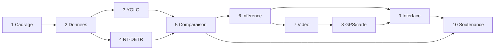

# RoadVision AI — Plan d'implémentation phase par phase

**Intitulé :** Intelligent Road Damage Detection & Mapping  
**Domaine :** Vision par ordinateur · Détection d'objets · Deep Learning · Cartographie  
**Type :** Projet académique expérimental + prototype de démonstration  
**Langue :** Français  
**Version :** 1.0

---

## 0. Vision générale et périmètre

### Résumé
RoadVision AI est un système de vision par ordinateur qui détecte et classe les dégradations de la chaussée à partir d'images, compare deux architectures de détection dans un cadre expérimental reproductible, et présente les prédictions dans une interface simple. En extension, il traite des vidéos et affiche sur une carte les défauts associés à de véritables coordonnées géographiques.

### Problématique
Comment détecter et classer automatiquement des dommages routiers sur des images réelles, malgré les variations de lumière, d'échelle et d'apparence, avec un compromis mesurable entre qualité de détection et rapidité d'inférence ?

### Priorités

| Niveau | Fonctionnalité | Statut prévu |
|---|---|---|
| P0 — Indispensable | Chargement du dataset, inspection des annotations, partitions sans fuite | Obligatoire |
| P0 — Indispensable | Détecteur de référence et entraînement/évaluation YOLO | Obligatoire |
| P0 — Indispensable | Deuxième approche RT-DETR ; comparaison équitable | Obligatoire si les ressources le permettent ; réduire le périmètre avec accord de l'enseignante sinon |
| P0 — Indispensable | Étude d'ablation, métriques, temps/ressources, analyse d'au moins 10 échecs/cas limites | Obligatoire |
| P1 — Recommandé | Prédiction d'images inédites et mini-interface | Après validation P0 |
| P2 — Extension | Traitement vidéo et limitation des doublons temporels | Facultatif |
| P2 — Extension | Cartographie à partir de GPS disponibles | Facultatif |
| P3 — Optionnel | Export GeoJSON/CSV et tableau de bord avancé | Facultatif |

**Règle centrale :** l'interface, la vidéo et la carte ne remplacent jamais la comparaison expérimentale.

### Classes de dommages
Conserver les catégories réellement définies par les annotations du corpus choisi. Pour RDD2022, les codes de dommages routiers couramment utilisés sont **D00** (fissure longitudinale), **D10** (fissure transversale), **D20** (fissuration en réseau / alligator) et **D40** (nid-de-poule). Vérifier les définitions et les classes présentes dans la version téléchargée ; ne pas ajouter de classe sans annotations fiables.

### Architecture logique



---

## Phase 1 — Cadrage scientifique et préparation de l'environnement

**Objectif :** transformer l'idée en problème mesurable et mettre en place un environnement reproductible.

### Tâches
- [ ] Rédiger le contexte, la problématique, les entrées, les sorties, les contraintes et les objectifs.
- [ ] Définir les hypothèses, **sans présumer** que l'un des modèles sera supérieur :
  - H1 : les architectures peuvent présenter des compromis différents entre mAP et latence.
  - H2 : certaines augmentations peuvent modifier la robustesse selon les conditions visuelles.
  - H3 : la résolution d'entrée peut influencer le rappel des petits dommages et les coûts d'inférence.
- [ ] Choisir une version précise de Python, PyTorch, CUDA et des bibliothèques de modèles.
- [ ] Identifier le GPU disponible et enregistrer mémoire VRAM, RAM et espace disque.
- [ ] Mettre en place Git, `requirements.txt` ou `pyproject.toml`, fichier de configuration et graines aléatoires.
- [ ] Définir **avant les tests** les métriques et les règles de sélection du meilleur modèle.

### Structure de dépôt proposée

```text
roadvision-ai/
├── README.md
├── requirements.txt
├── .gitignore
├── configs/
│   ├── dataset.yaml
│   ├── yolo.yaml
│   ├── rtdetr.yaml
│   └── experiments.yaml
├── data/
│   ├── raw/                # ignoré par Git
│   ├── processed/          # ignoré par Git
│   ├── splits/             # manifestes versionnés
│   └── metadata/
├── notebooks/
│   ├── 01_dataset_exploration.ipynb
│   └── 02_error_analysis.ipynb
├── src/
│   ├── data/
│   ├── training/
│   ├── evaluation/
│   ├── inference/
│   ├── video/
│   └── mapping/
├── app/
│   └── streamlit_app.py
├── scripts/
├── tests/
├── results/
│   ├── metrics/
│   ├── figures/
│   ├── failures/
│   └── resource_logs/
└── docs/
    ├── protocol.md
    ├── experiments.md
    └── final_report.md
```

### Livrables
- `README.md` initial et architecture.
- `docs/protocol.md` avec hypothèses, métriques et règles d'évaluation.
- Environnement Python fonctionnel, versions consignées.

**Critère de validation :** un autre membre peut cloner le dépôt et exécuter un script de diagnostic de l'environnement.

---

## Phase 2 — Acquisition, audit et préparation de RDD2022

**Objectif :** garantir un corpus cohérent et une séparation sans fuite d'information.

### Source envisagée
- **Road Damage Dataset (RDD2022)** : consulter les sources officielles et la documentation des annotations avant tout téléchargement.
- Point d'entrée connu : [RoadDamageDetector (GitHub)](https://github.com/sekilab/RoadDamageDetector). Vérifier la version RDD2022, les conditions d'utilisation et les liens de téléchargement effectivement disponibles.

### Tâches
- [ ] Télécharger une version documentée et accessible du corpus.
- [ ] Inventorier les images, dimensions, pays/domaines, classes, boîtes et images sans annotations.
- [ ] Inspecter les annotations visuellement : au moins cinq exemples au démarrage, dont deux cas difficiles.
- [ ] Mesurer la répartition par classe et la taille relative des boîtes.
- [ ] Détecter et éliminer les corruptions, identifier les doublons et quasi-doublons.
- [ ] Définir la politique des images négatives et des annotations incertaines.
- [ ] Créer les partitions apprentissage/validation/test **avant** toute optimisation.
- [ ] Éviter de placer des images identiques, des variantes d'une même source, ou des images quasi consécutives d'une même route dans des partitions différentes. Si les identifiants de trajet sont absents, expliquer la limite du protocole.
- [ ] Conserver le test intact, sans ajuster les hyperparamètres à partir de ses résultats.
- [ ] Enregistrer le manifeste de chaque image : identifiant, chemin relatif, split, source/groupe et graine.
- [ ] Convertir les annotations au format accepté par les deux pipelines, vérifier automatiquement les boîtes après conversion.

### Points critiques
- RDD2022 fournit des **images de dégâts et annotations**, mais la disponibilité de **GPS précis synchronisés** n'est pas garantie. **Ne pas inventer de coordonnées.** Pour la carte, il faudra un jeu vidéo/géographique dédié ou des coordonnées fournies séparément.
- Les métriques dépendent de la qualité des annotations ; documenter les ambiguïtés.

### Livrables
- `notebooks/01_dataset_exploration.ipynb`.
- `data/splits/manifest.csv`.
- `results/figures/classes_distribution.png` et exemples annotés.
- `docs/data_audit.md`.

**Critère de validation :** zéro image commune entre splits, format d'annotation vérifié et exemples d'annotations affichés correctement.

---

## Phase 3 — Baseline de référence et premier détecteur YOLO

**Objectif :** obtenir un résultat minimal reproductible et un premier point de comparaison.

### Tâches
- [ ] Construire une **référence simple** : par exemple un détecteur YOLO préentraîné utilisé en inférence sans adaptation, en expliquant la compatibilité imparfaite éventuelle des catégories ; ou un pipeline simple convenu avec l'enseignante.
- [ ] Choisir une variante YOLO légère compatible avec le GPU et archiver son identifiant exact, ses poids et les informations connues sur son préentraînement.
- [ ] Entraîner/fine-tuner sur `train` uniquement ; suivre `val` pour sélectionner les réglages et checkpoints.
- [ ] Fixer résolution, batch size, nombre maximal d'époques, optimiseur et politique d'arrêt dans la configuration.
- [ ] Conserver les logs, courbes de pertes et chemins des checkpoints.
- [ ] Vérifier des prédictions sur quelques images de validation (pas sur le test pour faire le choix de paramètres).
- [ ] Réaliser un test d'inférence sur une image nouvelle non préparée pour le contrôle oral.

### Métriques provisoires
- mAP@50 et mAP@50:95 ; precision/recall par classe ; faux positifs/faux négatifs.
- Latence en millisecondes par image, batch size, résolution, GPU, mémoire crête.

### Livrables
- `configs/yolo.yaml`, scripts d'entraînement/inférence.
- Poids sauvegardés localement (non nécessairement remis dans l'archive finale).
- `results/metrics/yolo_validation.csv` et visualisations.

**Critère de validation :** un lancement reproductible produit un checkpoint et des scores de validation interprétables.

---

## Phase 4 — Deuxième approche : RT-DETR

**Objectif :** comparer deux familles de détecteurs, et non simplement deux interfaces différentes.

### Tâches
- [ ] Sélectionner une implémentation RT-DETR reconnue, documenter version, configuration, poids et préentraînement.
- [ ] Réutiliser exactement les mêmes partitions et définitions de classes que YOLO.
- [ ] Adapter le format des annotations, les dimensions et les seuils d'appariement.
- [ ] Fixer un **budget de calcul comparable** : idéalement temps GPU total, nombre d'essais et enveloppe de réglage ; documenter les différences incompressibles.
- [ ] Entrainer/fine-tuner RT-DETR ; surveiller mémoire et temps.
- [ ] Mesurer les mêmes métriques et enregistrer les journaux.
- [ ] Documenter explicitement tout échec d'entraînement ou compromis (réduction du batch, résolution plus faible, gradient accumulation).

### Règle de faisabilité pour ~15 Go de VRAM
Commencer par un **essai court** avec une variante compacte, batch faible et résolution maîtrisée. La faisabilité dépend du modèle, du framework et du matériel. En cas d'échec, ajuster de façon documentée ; ne pas affirmer qu'une configuration fonctionne sans l'avoir exécutée.

### Livrables
- `configs/rtdetr.yaml`, scripts et journaux.
- `results/metrics/rtdetr_validation.csv`.

**Critère de validation :** deux pipelines évaluables avec la même convention de classes, de boîtes et de métriques.

---

## Phase 5 — Comparaison finale, ablation et analyse des erreurs

**Objectif :** produire la principale contribution académique du projet.

### Protocole
1. Définir et figer les configurations à partir de l'ensemble de validation.
2. Appliquer les modèles sur **le même test verrouillé**.
3. Utiliser les mêmes métriques et règles d'appariement.
4. Mesurer la latence après échauffement, de manière reproductible, sur le même matériel et à batch identique ; décrire précisément les étapes chronométrées.
5. Évaluer les métriques globales **et par classe**.
6. Comparer les résultats sans déclarer d'avance un gagnant.

### Tableau principal attendu

| Méthode | Taille entrée | mAP@50 | mAP@50:95 | Recall D40 | Latence ms/image | VRAM max | Temps entraînement |
|---|---:|---:|---:|---:|---:|---:|---:|
| Baseline | À remplir | — | — | — | — | — | — |
| YOLO | À remplir | — | — | — | — | — | — |
| RT-DETR | À remplir | — | — | — | — | — | — |

### Étude d'ablation obligatoire
**Question :** les augmentations d'images améliorent-elles réellement la robustesse ?

- Configuration A : modèle et résolution fixés, augmentations standards minimales.
- Configuration B : **même modèle et même protocole** avec une stratégie d'augmentation définie (luminosité/contraste ou autre).
- Comparer sur le même test. Ajouter, si pertinent, un sous-ensemble de validation perturbé **construit à partir de la validation**, sans fuite vers le test.
- Ne pas présenter les images altérées du test comme de nouvelles observations indépendantes ; tenir compte de l'origine commune.

**Variante alternative :** ablation de la résolution d'entrée, toutes autres conditions maintenues et budget mesuré.

### Analyse d'au moins dix échecs/cas limites
Pour chaque exemple : identifiant image, vérité terrain, prédiction, type d'échec, hypothèse explicative et suggestion d'amélioration. Si le système échoue moins de dix fois, compléter par des décisions incertaines ou fragiles **sans inventer des erreurs**.

Exemples de conditions à analyser : ombres, fissures fines, objet très petit, chaussée humide, marquages routiers, faible contraste, occlusion, texture trompeuse, perspective et image compressée.

### Livrables
- `results/metrics/final_comparison.csv`.
- Graphiques précision-rappel, AP par classe, temps de traitement et exemple de prédictions.
- `notebooks/02_error_analysis.ipynb`.
- `docs/experiments.md` complété avec paramètres et résultats effectifs.

**Critère de validation :** résultats attribuables à des configurations identifiées, ablation interprétée et au moins dix analyses de cas documentées.

---

## Phase 6 — Inférence et traitement d'images nouvelles

**Objectif :** créer un module d'inférence fiable et réutilisable.

### Tâches
- [ ] Charger le modèle retenu et le mapping des classes.
- [ ] Recevoir une image, vérifier le format, limiter dimensions et taille de fichier.
- [ ] Retourner boîtes englobantes, classes, confiance **non assimilée automatiquement à une probabilité calibrée**, et temps de traitement.
- [ ] Appliquer le seuil de confiance réglé sur validation et la politique de suppression des doublons propre au détecteur.
- [ ] Dessiner les résultats sur une copie de l'image.
- [ ] Gérer les cas « aucun dommage détecté », fichier invalide et exécution sans GPU.
- [ ] Ajouter quelques tests automatisés (chargement, image vide/invalide, schéma de sortie).

### Contrat de sortie proposé

```json
{
  "image_id": "sample_001",
  "model_version": "roadvision_yolo_v1",
  "detections": [
    {"class_code": "D40", "label": "nid-de-poule", "confidence": 0.86, "bbox_xyxy": [120, 84, 260, 195]}
  ],
  "inference_ms": 24.5
}
```

> **Illustration de structure uniquement :** les valeurs ne sont pas des résultats expérimentaux.

### Livrables
- `src/inference/predict.py` et tests.
- CLI documentée : `python scripts/predict_image.py --input chemin/image.jpg` (à implémenter).

**Critère de validation :** prédiction exécutable sur une image nouvelle, avec schéma stable et gestion des erreurs.

---

## Phase 7 — Extension vidéo (facultative)

**Objectif :** analyser les images d'une vidéo et éviter, autant que possible, de compter plusieurs fois le même dommage.

### Tâches
- [ ] Charger un fichier vidéo local, lire FPS et dimensions, traiter à fréquence définie.
- [ ] Exécuter la détection sur des frames sélectionnées.
- [ ] Mesurer FPS réel, latence et consommation mémoire.
- [ ] Tester une stratégie simple de liaison temporelle (IoU/associations de boîtes ou suivi compatible avec caméra mobile), avec seuil choisi sur une séquence de développement.
- [ ] Comparer le nombre brut de détections au nombre d'événements consolidés ; ne pas les confondre avec le nombre exact de défauts sans vérité terrain adaptée.
- [ ] Exporter une vidéo annotée et un journal d'événements.

### Limitations à déclarer
Un détecteur entraîné sur des **images RDD2022** n'est pas automatiquement validé sur une vidéo issue d'une autre caméra. Pour mesurer des performances vidéo, constituer un petit corpus vidéo annoté, distinct des données utilisées pour régler les paramètres. La consolidation est difficile avec le déplacement rapide de la caméra et les changements de perspective.

### Livrables
- `src/video/process_video.py`.
- Vidéo démonstrative annotée, `results/video_events.csv`.

**Critère de validation :** traitement d'une vidéo de bout en bout sans crash, avec mesures de temps et limitations explicites.

---

## Phase 8 — Géolocalisation et cartographie (facultative)

**Objectif :** afficher sur carte **uniquement les dommages dont une localisation est justifiable**.

### Sources de coordonnées possibles
1. Coordonnées GPS jointes à l'image, **si présentes et vérifiées**.
2. Journal GPS synchronisé avec les timestamps d'une vidéo.
3. Petit jeu de démonstration créé avec positions relevées de manière autorisée.

**Interdit méthodologiquement :** attribuer arbitrairement des GPS à des images RDD2022 et les présenter comme leurs lieux réels.

### Tâches
- [ ] Définir `event_id`, `image_id`/`video_timestamp`, `latitude`, `longitude`, `class_code`, `confidence`, `source_gps`.
- [ ] Synchroniser la vidéo et les coordonnées si un journal GPS est utilisé ; documenter les erreurs de temps possibles.
- [ ] Fusionner autant que possible les occurrences répétées du même événement.
- [ ] Exclure les événements sans GPS valide du **mode carte réelle** ; les montrer dans une vue « non géolocalisé ».
- [ ] Afficher les points avec Folium/Leaflet et proposer un filtre par type de dommage.
- [ ] Exporter CSV/GeoJSON avec provenance et niveau de fiabilité de localisation.
- [ ] Ne pas assimiler la position GPS du véhicule à la position exacte du dommage : expliciter cette approximation.

### Livrables
- `src/mapping/geolocate.py`, `src/mapping/map_builder.py`.
- Carte locale de démonstration et export des événements.

**Critère de validation :** tout marqueur réel possède une source GPS traçable ; aucun point fictif n'est présenté comme observation réelle.

---

## Phase 9 — Interface de démonstration (facultative après le socle)

**Objectif :** rendre les résultats accessibles sans perdre la traçabilité scientifique.

### Choix conseillé
**Streamlit** pour le prototype pédagogique ; API FastAPI + interface React uniquement si le temps le permet.

### Écrans
- **Analyse d'une image :** import, résultat annoté, liste des défauts, temps d'inférence.
- **Analyse vidéo :** import, exécution, vidéo résultante et tableau d'événements (extension).
- **Carte :** points GPS véritables, filtres et export (extension).
- **Expériences :** tableau comparatif YOLO/RT-DETR, courbes, ablation, limites.

### Tâches
- [ ] Valider les formats d'entrée et afficher des erreurs explicites.
- [ ] Ajouter le nom et la version du modèle sélectionné.
- [ ] Éviter toute affirmation non soutenue (« précision garantie », « géolocalisation exacte », etc.).
- [ ] Tester des images nouvelles et le cas sans détection.

### Livrables
- `app/streamlit_app.py` et guide de lancement.
- Captures d'écran utilisables dans la soutenance.

**Critère de validation :** démonstration reproductible en local, sans dépendance à un service externe indispensable.

---

## Phase 10 — Qualité, documentation, rapport et soutenance

**Objectif :** finaliser un projet évalué sur ses expériences et sur sa compréhension technique.

### Tests finaux
- [ ] Vérifier l'absence de fuite entre partitions.
- [ ] Relancer l'inférence et l'évaluation à partir des configurations sauvegardées.
- [ ] Contrôler versions, graines, provenance des poids et contraintes/licences des jeux de données.
- [ ] Vérifier les chemins relatifs, dépendances et `README.md`.
- [ ] Préparer une démonstration sur une **image non préparée**.
- [ ] Être capable de changer individuellement un seuil, une résolution ou un paramètre et d'en expliquer l'effet.
- [ ] Déclarer les morceaux de code externes et l'aide de l'IA.

### Rapport conseillé
1. Contexte, problématique et objectifs.
2. Travaux et architectures étudiés.
3. Présentation/audit du corpus et protocole expérimental.
4. Méthodes : baseline, YOLO et RT-DETR.
5. Résultats quantitatifs, ablation, temps/ressources.
6. Analyse d'au moins dix échecs/cas limites.
7. Prototype et extensions réellement mises en œuvre.
8. Discussion, limites et perspectives.

### Dépôt final
- Notebook reproductible, scripts, configurations, `README` avec commandes exactes, manifeste de partitions, métriques et graphiques, analyse des erreurs, compte rendu et rapport demandé par l'enseignante.
- **Ne pas joindre les corpus complets, gros poids de modèles ni l'environnement Python**, sauf consigne contraire. Fournir des liens d'accès et instructions de reconstruction.

**Critère de validation :** un évaluateur peut reconstruire l'environnement, retrouver les expériences, interpréter les métriques et tester une nouvelle image.

---

## Ordre de travail et dépendances



### Jalons de validation (gates)

| Jalon | Preuve indispensable | Si non validé |
|---|---|---|
| G1 — Projet cadré | Protocole écrit et environnement lancé | Ne pas débuter l'entraînement |
| G2 — Données correctes | Audit, annotations visibles, splits sans fuite | Corriger les données |
| G3 — Première méthode | YOLO reproductible et métriques validation | Déboguer avant RT-DETR |
| G4 — Deux approches | RT-DETR et YOLO comparables | Documenter l'obstacle et faire valider une adaptation |
| G5 — Science terminée | Test final, ablation, ressources, 10 cas analysés | Ne pas privilégier le dashboard |
| G6 — Prototype utilisable | Inférence nouvelle image, erreurs gérées | Stabiliser l'inférence |
| G7 — Extensions | Vidéo et carte avec provenance des métadonnées | Présenter comme travaux futurs |
| G8 — Remise | Reproductibilité, rapport, démonstration | Compléter la documentation |

---

## Répartition indicative des efforts

| Bloc | Part approximative du travail |
|---|---:|
| Cadrage + données | 20 % |
| Implémentation des deux méthodes | 35 % |
| Évaluation, ablation, analyse | 25 % |
| Inférence + éventuelles extensions | 15 % |
| Rapport et soutenance | 5 % |

> Ces pourcentages sont indicatifs, pas un calendrier garanti. Prévoir davantage d'effort pour l'analyse et la documentation si les expériences sont exigeantes.

---

## Critères de réussite du projet

**Réussite académique minimale :** données propres, comparaison défendable de méthodes, protocole équitable, métriques détaillées, ablation et analyse documentée des cas limites.

**Réussite technique :** un script prend une image nouvelle et retourne des détections utilisables avec une latence mesurée.

**Réussite étendue :** le système traite de la vidéo et visualise des observations géolocalisées **quand de vraies coordonnées sont disponibles**.

**Point de vigilance :** les fichiers, expériences et composants décrits dans ce plan sont des **livrables à créer**, pas des fonctionnalités déjà réalisées. Les chiffres d'exemple ne sont pas des résultats mesurés.

---

## Références de démarrage

- Catalogue du cours : *VPO_Projets_Groupe_1.pdf* (exigences transversales du cours de vision par ordinateur : comparaisons, ablation, partitions, cas limites, ressources, reproductibilité).
- Projet et informations sur RDD : https://github.com/sekilab/RoadDamageDetector
- Documentation PyTorch : https://pytorch.org/docs/stable/index.html
- Ultralytics (YOLO / options RT-DETR selon la version) : https://docs.ultralytics.com/
- Streamlit : https://docs.streamlit.io/
- Folium : https://python-visualization.github.io/folium/

**Avant le lancement :** faire valider par l'enseignante que RoadVision AI, projet externe au catalogue, et son protocole YOLO/RT-DETR peuvent remplacer une mission V01–V37.
